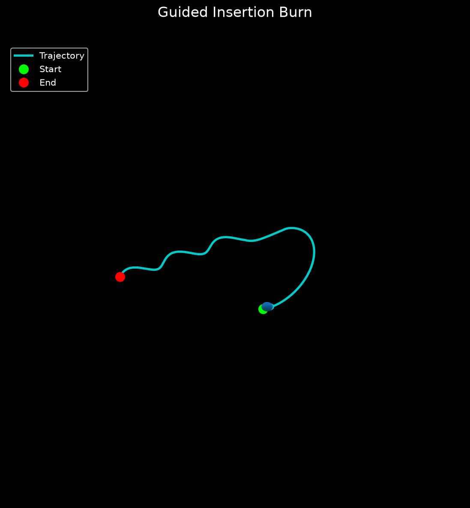
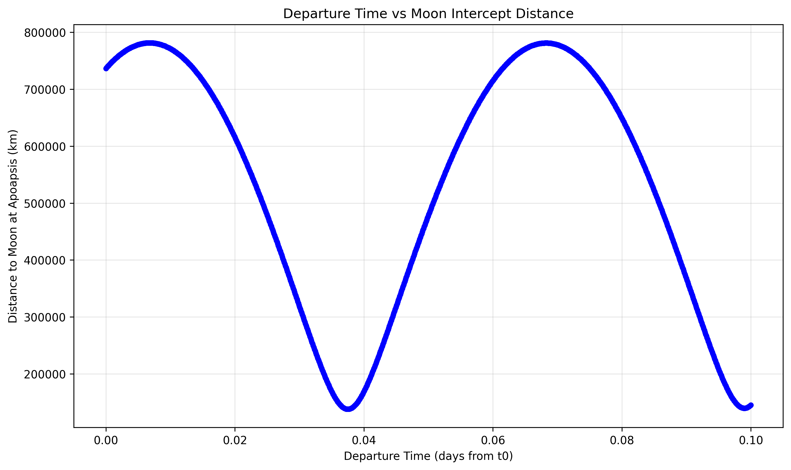
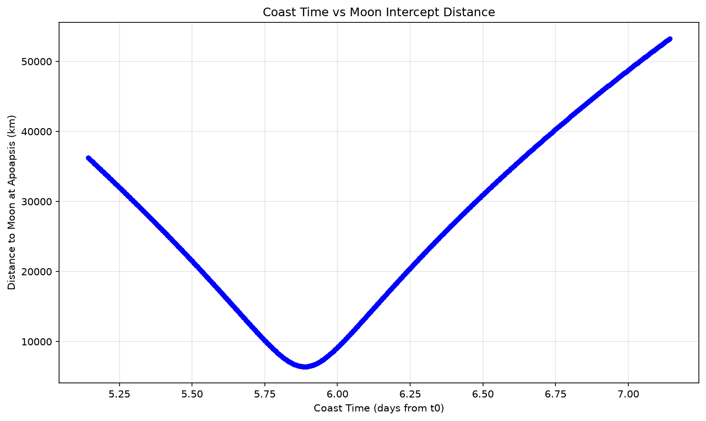
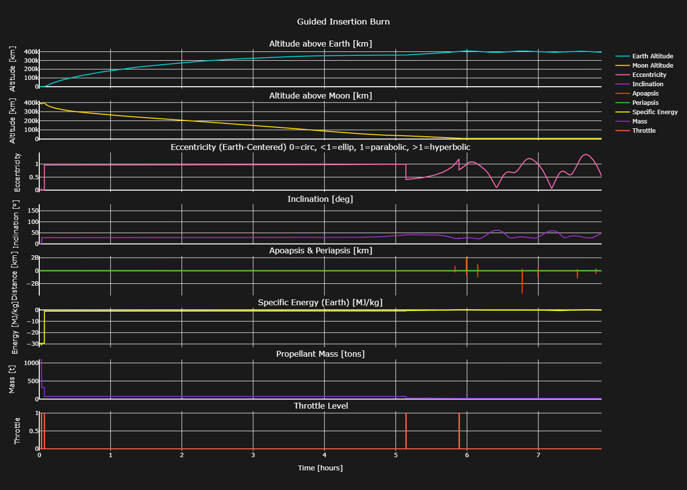
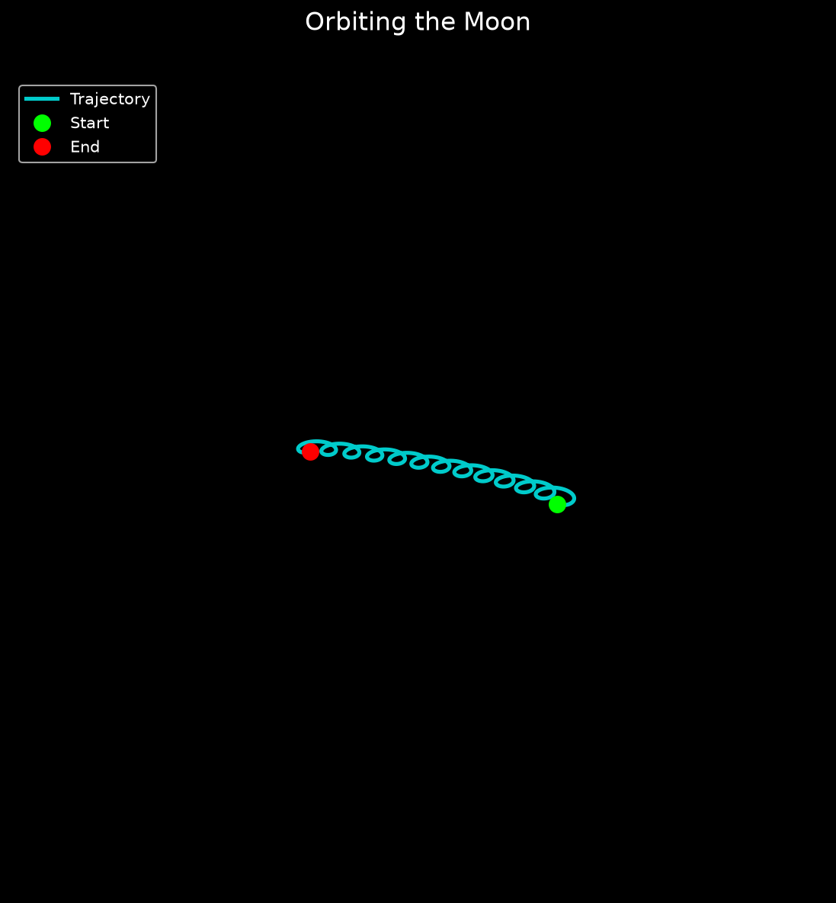
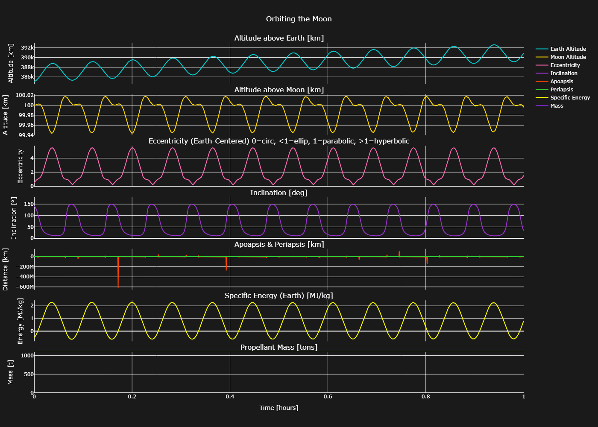

# Space State

A spacecraft trajectory simulator written from scratch in Python, paired with the start of a real-time guidance computer on a Teensy 4.1. Space State flies a spacecraft through the real solar system: seven bodies at their true positions from NASA JPL's DE440 ephemeris. It plans maneuvers with classical orbital mechanics and flies them as finite burns with real engine models.

The showcase is a complete Earth-to-Moon mission. A Starship-class vehicle leaves low Earth orbit, tilts its orbit into the Moon's plane, burns for the Moon, and is captured into lunar orbit **7.9 days later**.

<p align="center">
  
</p>

*The full mission from the simulator's own 3D view (`visual/star_vis3D.py`), centred on Earth. The ship starts in low Earth orbit (green), climbs out to the Moon, and loops around it until the run ends (red). From a run of `tests/guidance_controller.py`.*

A personal research project, built in my spare time.

---

## The Earth-to-Moon mission

`tests/guidance_controller.py` flies the whole mission with SpaceX Starship's figures: 3 Raptor Vacuum engines, 120 t dry mass and 1,100 t of propellant. Each maneuver is planned with two-body formulas, then flown in full seven-body gravity. The next maneuver is planned from wherever the ship actually ended up.

| # | Burn | When | Δv | Burn time | What it does |
|---|---|---|---|---|---|
| 1 | Plane change | 0.03 d | 3,762 m/s | 370 s | Tilts the orbit 28.4° at the ascending node to match the Moon's orbital plane |
| 2 | Trans-lunar injection | 0.07 d | 3,086 m/s | 120 s | Hohmann burn from 6,772 km out to the Moon's distance, timed so the Moon is there on arrival |
| 3 | Lunar orbit insertion | 5.14 d | — | 21 s | Slows the ship near the Moon (36,000 km out, 0.51 km/s relative) |
| 4 | Circularization | 5.89 d | 312 m/s | 6 s | Circular orbit around the Moon at the point of closest approach |

The plane change flies 28.2° of the planned 28.4°, leaving the orbit within 1° of the Moon's plane.

The ship then coasts for 2 days in a stable orbit 6,417–6,449 km above the Moon. Its energy relative to the Moon stays negative, so it is captured. The mission uses 1,082 t of propellant (98%), most of it on the plane change. Simulating the 7.9 days takes about 4 minutes.

<p align="center">
  
  
</p>

*Left: the departure-time sweep. For each candidate departure the planner predicts where the ship reaches apoapsis and how far that is from the Moon; the transfer burn goes at the minimum. Right: the search for closest approach after insertion. It propagates 1,000 coast times in full N-body gravity and picks the minimum, 6,424 km at 5.89 days.*



*The built-in mission dashboard (`visual/star_vis2D.py`) shows altitude above Earth and Moon, eccentricity, inclination, apsides, energy, propellant and throttle. The four burns are the throttle spikes. (The time axis is in days; its label still says hours.)*

### Holding a low lunar orbit

`tests/orbit_moon.py` places the ship in a 100 km circular orbit around the Moon and propagates it for 24 hours under seven-body gravity. The altitude stays between **99.94 and 100.02 km** for all 12 revolutions: a good check that the integrator, constants and frame conversions agree.

<p align="center">
  
  
</p>

*Left: the 3D view of the 24 hours. The Moon carries the orbit along its own path, so the 12 laps trace a coil. Right: the metrics dashboard for the same run; the Moon altitude panel shows the 0.08 km band.*

---

## How it works

```
mission script  ->  maneuver planner  ->  burn controller  ->  propagator  <->  dynamics
 (which burns)      (Δv, when, which      (Δv -> burn window,   (DOP853,          (7-body gravity
                     direction)            throttle, pointing)    1e-9 tolerance)    + thrust + mass flow)
```

**Equations of motion.** The state is position, velocity and mass in the Solar System Barycentric frame (AU, AU/day, kg). Gravity is summed over the Sun, Earth, Moon, Venus, Mars, Jupiter and Saturn, at their DE440 positions $\mathbf{r}_k(t)$:

```math
\dot{\mathbf{r}} = \mathbf{v}, \qquad
\dot{\mathbf{v}} = -\sum_{k} \mu_k \frac{\mathbf{r}-\mathbf{r}_k(t)}{\lVert \mathbf{r}-\mathbf{r}_k(t) \rVert^{3}} + \frac{T\tau}{m}\,\hat{\mathbf{u}}, \qquad
\dot{m} = -\frac{T\tau}{I_{sp}\, g_0}
```

**Integration.** `scipy.integrate.solve_ivp` with DOP853 (8th-order Runge–Kutta), `rtol = atol = 1e-9`, with steps of at most 60 s while coasting and 2 s during burns. Propagation is split at every burn's start and end, so thrust never switches inside a step.

**Planning with two-body orbital mechanics** (`base/star_states.py`, `guidance/star_tools.py`):

- **Plane change:** integrate to the ascending node of the ship's orbit relative to the Moon's plane, then rotate the velocity by Δi about the line of nodes. That costs $\Delta v = 2v\sin(\Delta i/2)$.
- **Trans-lunar injection:** a Hohmann transfer with $a_t = (r_1 + r_2)/2$. The vis-viva equation $v = \sqrt{\mu(2/r - 1/a)}$ gives the burn.
- **Departure timing:** a sweep over departure times. Each candidate gets its apoapsis time from Kepler's equation ($M = E - e\sin E$) and is compared with where the Moon will be.
- **Arrival:** circularize at apoapsis, search for the closest approach to the Moon with full N-body propagation, then set the velocity to the Moon's circular speed $\sqrt{\mu_{Moon}/r}$ in the same plane.

**Finite burns** (`guidance/test_burn.py`). Every Δv becomes a real burn using the rocket equation:

```math
m_f = m_0\, e^{-\Delta v / v_e}, \qquad
t_{burn} = \frac{m_0 - m_f}{\dot m}
```

The burn is centred on the ideal impulse time. During it, `BurnController` commands throttle and thrust direction while the propagator drains propellant from the state vector.

The derivations of the orbital-element formulas (angular momentum, eccentricity vector, inclination, energy, anomalies, apoapsis state) are in [`document/document.tex`](document/document.tex).

---

## Features

### Simulation (`space_state/base`)
- **N-body dynamics:** body positions from Skyfield + JPL DE440; gravitational parameters and radii from NAIF kernels (`gm_de440.tpc`, `pck00011.tpc`).
- **Spacecraft and engine models:** throttleable thrusters with thrust, Isp, exhaust velocity and mass flow; propellant drains during burns. Presets: **SpaceX Starship** (3× Raptor Vacuum), **ULA Centaur III** (RL10C-1-1) and **Lockheed Agena** (Bell 8096).
- **Integrator events:** terminal events for engine ignition, cutoff and propellant depletion.
- **Orbit catalog:** named Earth orbits (LEO, ISS, Starlink, GPS, GEO/GSO, Molniya, TLI) and lunar orbits (100 km LLO, NRHO, DRO, …).
- **Results container:** `PropagationResult` collects time, state history, guidance cycles and events across mission phases.

### Guidance (`space_state/guidance`)
- **`BurnController`:** turns a maneuver (Δv, burn centre time, direction) into a burn window from the ship's engines, and commands thrust direction and throttle. The main mission uses it.
- **`FiniteBurnZEMZEV` / `FiniteBurnZEMZEV_V2`:** experimental Zero-Effort-Miss / Zero-Effort-Velocity finite-burn guidance with powered-flight prediction (work in progress).
- **`GuidanceProtocol`:** the interface every controller implements, `update(t, y) -> (vgo, thrust_dir, throttle)`.
- **Orbital-element tools:** inclination, eccentricity, specific energy, semi-major axis, vis-viva, period, nodes, time to apoapsis, and burn duration from the rocket equation.

### Visualization (`space_state/visual`)
- 2D orbital metrics over time (the dashboard above).
- 3D trajectory plots and an orbital-plane comparison.
- A text mission summary (`review`).

### Flight computer (`src/`)
- **`src/main/guidance.cpp`:** a FreeRTOS guidance computer for the Teensy 4.1. A receive task reads 56-byte state packets (7 doubles) over USB serial at 2 Mbaud and queues them to a guidance task. The guidance task echoes each packet and logs it to the SD card as CSV, flushing every 100 ms.
- **`src/test/`:** bring-up tests: LED blink under FreeRTOS, serial throughput, a serial echo/ping-pong, and a quaternion math test using CMSIS-DSP.

---

## Repository layout

```
space_state/
├── space_state/                 # Python simulator (run from this directory)
│   ├── base/                    # Core: config, constants, dynamics, propagator, ship, states
│   ├── guidance/                # Guidance controllers and orbital-mechanics tools
│   ├── visual/                  # 2D/3D plotting, mission review, README images
│   ├── tests/                   # Mission scenarios (Earth→Moon, lunar orbit, porkchop)
│   ├── validation/              # pytest unit tests (spacecraft model)
│   └── mission.py               # Earlier standalone mission script
├── src/
│   ├── main/guidance.cpp        # Teensy 4.1 FreeRTOS guidance computer
│   └── test/                    # Firmware bring-up tests
├── document/document.tex        # Orbital mechanics reference (LaTeX)
└── platformio.ini               # PlatformIO build environments
```

---

## Getting started: simulator

### 1. Environment

```bash
python -m venv rocket_sim
source rocket_sim/bin/activate      # Windows: rocket_sim\Scripts\activate

pip install "numpy<2.5" scipy matplotlib "astropy<7.2" skyfield tqdm pytest plotly
```

Use astropy 7.1 or earlier: `guidance/star_tools.py` imports `astropy.coordinates.earth_orientation`, which astropy 7.2 removed. Those astropy versions also need numpy below 2.5. Tested with astropy 7.1.1, numpy 2.3.5, scipy 1.18, matplotlib 3.11, skyfield 1.55 and plotly 6. `ffmpeg` is useful for saving animations.

### 2. Ephemeris files

The simulator loads its kernels from `./ephemeris/`, relative to the working directory `space_state/space_state/`. This folder is git-ignored, so set it up yourself:

```bash
cd space_state
mkdir ephemeris && cd ephemeris
curl -O https://naif.jpl.nasa.gov/pub/naif/generic_kernels/pck/gm_de440.tpc
curl -O https://naif.jpl.nasa.gov/pub/naif/generic_kernels/pck/pck00011.tpc
curl -O https://ssd.jpl.nasa.gov/ftp/eph/planets/bsp/de440.bsp     # about 115 MB
```

### 3. Run a scenario

Imports are relative to the `space_state/space_state/` folder (`from base import ...`), so run from there:

```bash
cd space_state

# Full Earth → Moon mission: plane change, TLI, lunar orbit insertion (about 4 minutes)
python -m pytest tests/guidance_controller.py -s

# 24 hours in a 100 km lunar orbit (about 25 seconds)
python -m pytest tests/orbit_moon.py -s
```

The scenarios log each burn (time, Δv, inclination change, distance and speed relative to the Moon), print an orbit summary, then open the 2D metrics dashboard and the 3D trajectory plots.

Simulation settings (epoch, tolerances, maximum step, which bodies to include) are in `base/star_config.py`. The default epoch is 2025-11-14 00:00 UTC.

---

## Getting started: flight computer

Hardware: **Teensy 4.1** (i.MX RT1062, Cortex-M7 at 600 MHz) with an SD card in the built-in slot.
Toolchain: **PlatformIO**, the Teensyduino Arduino core, and [freertos-teensy](https://github.com/tsandmann/freertos-teensy).

```bash
pacman -Syu teensy-loader-cli   # or install teensy_loader_cli another way
```

Build and upload with these PlatformIO environments:

| Environment     | Source                  | Purpose                                  |
|-----------------|-------------------------|------------------------------------------|
| `guidance`      | `src/main/guidance.cpp` | Guidance computer (default)              |
| `test_blink`    | `src/test/blink.cpp`    | LED blink under FreeRTOS                 |
| `test_serial`   | `src/test/serial.cpp`   | Serial logging / throughput              |
| `test_connect`  | `src/test/connect.cpp`  | Serial echo (ping-pong) with the host    |

```bash
# build
pio run -e guidance

# upload
pio run -e guidance --target upload
pio run --target upload            # default env is guidance

# serial monitor (2 Mbaud)
pio device monitor
```

---

## Status

Space State is an active personal project. The propagator, ship model, maneuver planning and the `BurnController`-driven Earth→Moon mission all work. The mission was last re-run in November 2026 with the results above.

**Next steps:**
- **Closed-loop guidance.** The burns are planned once and flown without correction, so the ship is captured at 6,400 km rather than a chosen orbit such as 100 km. Finishing the ZEM/ZEV guidance (`finite_burn_zemzev*.py`), or adding mid-course corrections, is the next step.
- **Hardware in the loop.** The Teensy receives and logs state today; the Python side that streams state to it and accepts commands back is next.
- **Speed.** Every gravity evaluation queries Skyfield for each body's position. Caching or interpolating the ephemeris would make long runs and parameter sweeps much faster.
- **Atmospheric drag.** There is a placeholder hook in the dynamics.

**Known issues:**
- `validation/test_ship.py` still calls `ship.set_throttle()`; the spacecraft now uses a `throttle` property.
- `tests/porkchop_earth_moon.py` and `mission.py` predate the current API and are kept for reference.
- The metrics dashboard labels its time axis in hours, but the values are days.
