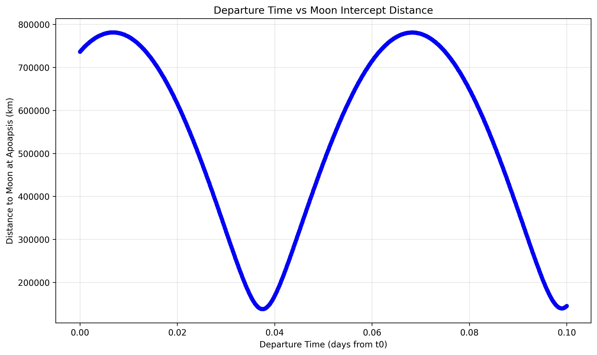

# Space State

A spacecraft trajectory simulator and guidance experiment, written from scratch in Python, paired with a real-time guidance computer running on a Teensy 4.1.

The Python side propagates a spacecraft through a full N-body solar system (Sun, Earth, Moon, Venus, Mars, Jupiter, Saturn) using JPL DE440 ephemerides, plans maneuvers with classical orbital mechanics, and flies them as finite burns with real engine models and mass depletion. The main scenario is a complete Earth-to-Moon mission: LEO → plane change → trans-lunar injection → lunar orbit insertion.

The firmware side is the start of a hardware-in-the-loop setup: the simulator streams the ship's state over high-speed USB serial to a FreeRTOS guidance computer, which receives it, processes it, and logs it to SD.



*Sweep of trans-lunar departure times against the miss distance to the Moon at apoapsis, used to pick the departure window.*

---

## Features

### Simulation (`space_state/base`)
- **N-body dynamics.** Gravitational acceleration from every configured body, with positions taken from Skyfield + JPL DE440 and gravitational parameters/radii from NAIF kernels (`gm_de440.tpc`, `pck00011.tpc`).
- **High-accuracy propagation.** `scipy.integrate.solve_ivp` with DOP853, tight tolerances (`rtol = atol = 1e-9`), and a capped step size. The state is `[r, v, m]` in the Solar System Barycentric frame, in AU, AU/day and kg.
- **Spacecraft and engine models.** Throttleable thrusters with thrust, Isp, exhaust velocity and mass flow; propellant drains during burns. Presets: **SpaceX Starship** (3× Raptor Vacuum), **ULA Centaur III** (RL10C-1-1) and **Lockheed Agena** (Bell 8096).
- **Integrator events.** Terminal events for engine ignition, engine cutoff and propellant depletion, so the integrator stops exactly when a burn switches.
- **Orbit catalog.** Named Earth orbits (LEO, ISS, Starlink, GPS, GEO/GSO, Molniya, TLI) and lunar orbits (100 km LLO, NRHO, DRO, …).
- **Results container.** `PropagationResult` collects time, state history, guidance cycles and events across multiple mission phases.

### Maneuver planning (`space_state/base/star_states.py`, `space_state/guidance/star_tools.py`)
- Circular orbit states around any body.
- Hohmann transfer burns at a chosen time.
- Circularization at apoapsis.
- Plane change at the ascending node to match the Moon's orbital plane.
- Moon-intercept search over departure times to find the best TLI window.
- Lunar orbit insertion (circular, plus an Apollo-style elliptical capture variant).
- Orbital-element tools: inclination, eccentricity, specific energy, semi-major axis, vis-viva, period, nodes, time to apoapsis, and burn-duration estimates from the rocket equation.

### Guidance (`space_state/guidance`)
- **`BurnController`:** takes a maneuver target (Δv, burn center time, direction), works out the burn start and end times from the ship's engines, and commands thrust direction and throttle during the burn. This is what the main mission scenario uses.
- **`FiniteBurnZEMZEV` / `FiniteBurnZEMZEV_V2`:** experimental Zero-Effort-Miss / Zero-Effort-Velocity finite-burn guidance with powered-flight prediction (work in progress).
- **`GuidanceProtocol`:** the interface any controller implements: `update(t, y) -> (vgo, thrust_dir, throttle)`.

### Visualization (`space_state/visual`)
- 2D orbital metrics over time (altitude, speed, inclination, eccentricity, energy, mass, throttle).
- 3D trajectory plots.
- Orbital-plane comparison plots.
- A text mission summary (`review`).

### Flight computer (`src/`)
- **`src/main/guidance.cpp`:** a FreeRTOS guidance computer for the Teensy 4.1. A receive task reads 56-byte state packets (7 doubles) over USB serial at 2 Mbaud and queues them to a guidance task. The guidance task echoes each packet and buffers it into a CSV log on the built-in SD card, flushing every 100 ms.
- **`src/test/`:** bring-up tests: LED blink under FreeRTOS, serial throughput logging, a serial echo/ping-pong, and a quaternion math test using CMSIS-DSP.

### Reference document (`document/document.tex`)
A LaTeX write-up of the orbital mechanics formulas used in the code: angular momentum, eccentricity, inclination, energy, semi-major axis, anomalies and the apoapsis state.

---

## Repository layout

```
space_state/
├── space_state/                 # Python simulator (run from this directory)
│   ├── base/                    # Core: config, constants, dynamics, propagator, ship, states
│   ├── guidance/                # Guidance controllers and orbital-mechanics tools
│   ├── visual/                  # 2D/3D plotting and mission review
│   ├── tests/                   # Mission scenarios (Earth→Moon, lunar orbit, porkchop)
│   ├── validation/              # pytest unit tests (spacecraft model)
│   └── mission.py               # Earlier standalone mission script
├── src/
│   ├── main/guidance.cpp        # Teensy 4.1 FreeRTOS guidance computer
│   └── test/                    # Firmware bring-up tests
├── document/document.tex        # Orbital mechanics reference (LaTeX)
└── platformio.ini               # PlatformIO build environments
```

---

## Getting started: simulator

### 1. Environment

```bash
python -m venv rocket_sim
source rocket_sim/bin/activate

pip install numpy scipy matplotlib astropy skyfield tqdm pytest
pip install h5py ruff mypy black   # optional dev tools
```

`ffmpeg` is useful for saving animations (on MSYS2: `pacman -Syu ffmpeg`).

### 2. Ephemeris files

The simulator loads its kernels from `./ephemeris/` relative to the working directory, which is `space_state/space_state/`. This folder is git-ignored, so set it up yourself:

```bash
cd space_state
mkdir ephemeris
cd ephemeris
curl -O https://naif.jpl.nasa.gov/pub/naif/generic_kernels/pck/gm_de440.tpc
curl -O https://naif.jpl.nasa.gov/pub/naif/generic_kernels/pck/pck00011.tpc
```

Skyfield downloads `de440.bsp` automatically on first run (about 115 MB).

### 3. Run a scenario

Imports are relative to the `space_state/space_state/` folder (`from base import ...`), so run from there:

```bash
cd space_state

# Full Earth → Moon mission: LEO, plane change, TLI, lunar orbit insertion
python -m pytest tests/guidance_controller.py -s

# Coast in a 100 km lunar orbit
python -m pytest tests/orbit_moon.py -s

# Spacecraft model unit tests
python -m pytest validation/test_ship.py
```

The scenarios log each burn (time, Δv, inclination change, distance and speed relative to the Moon), then open the 2D metrics and 3D trajectory plots.

Simulation settings (epoch, tolerances, max step, which bodies to include) are in `base/star_config.py`. The default epoch is 2025-11-14 00:00 UTC.

---

## Getting started: flight computer

Hardware: **Teensy 4.1** (i.MX RT1062, Cortex-M7 @ 600 MHz) with an SD card in the built-in slot.
Toolchain: **PlatformIO**, the Teensyduino Arduino core, and [freertos-teensy](https://github.com/tsandmann/freertos-teensy).

```bash
pacman -Syu teensy-loader-cli   # or install teensy_loader_cli another way
```

Build and upload with these PlatformIO environments:

| Environment     | Source                  | Purpose                                  |
|-----------------|-------------------------|------------------------------------------|
| `guidance`      | `src/main/guidance.cpp` | Guidance computer (default)              |
| `test_blink`    | `src/test/blink.cpp`    | LED blink under FreeRTOS                 |
| `test_serial`   | `src/test/serial.cpp`   | Serial logging / throughput              |
| `test_connect`  | `src/test/connect.cpp`  | Serial echo (ping-pong) with the host    |

```bash
# build
pio run -e guidance

# upload
pio run -e guidance --target upload
pio run --target upload            # default env is guidance

# serial monitor (2 Mbaud)
pio device monitor
```

---

## Status

Space State is an active personal project. The propagator, ship model, maneuver planning and `BurnController`-driven Earth→Moon scenario all work. Still in progress:

- ZEM/ZEV finite-burn guidance (`finite_burn_zemzev*.py`)
- Closing the hardware-in-the-loop loop: right now the Teensy receives and logs state, and the next step is sending guidance commands back to the simulator
- `mission.py` predates the current API and is kept for reference
- Atmospheric drag (there is a placeholder hook in the dynamics)
